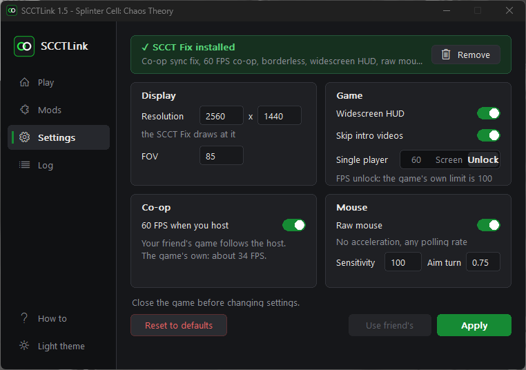
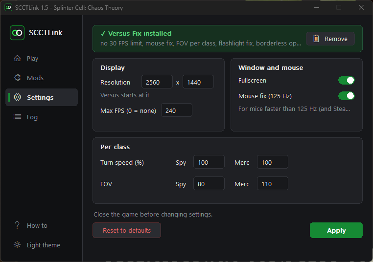
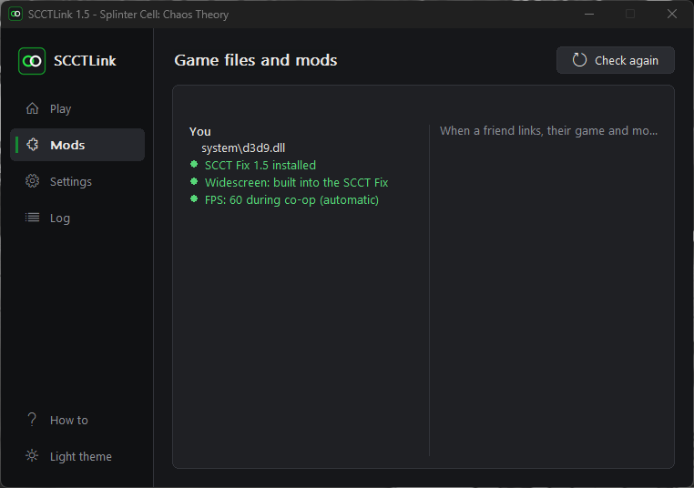
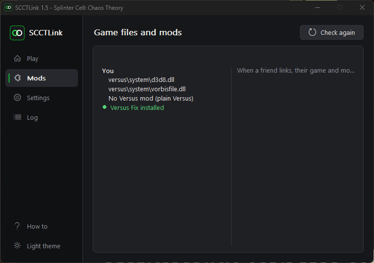

# SCCTLink

**Splinter Cell: Chaos Theory co-op and Versus with your Steam friends, after the official servers went dark.**
No VPN, no port forwarding, no strangers: only your Steam friends can join, and nobody sees anyone's IP address.

By Mhdshehri. **[Download the latest release](../../releases/latest)** (Windows, one zip, nothing to install).


| Settings: co-op | Settings: Versus |
|---|---|
|  |  |
| **Mods: co-op** | **Mods: Versus** |
|  |  |

## What you get

- **Co-op (2 players):** the campaign, with the **SCCT Fix**: co-op no longer drifts apart and disconnects, and it can run at **60 FPS** in missions (the game's own is about 34).
- **Versus (up to 4 players):** Spies vs. Mercenaries in a private game, with the **Versus Fix** for today's PCs. For public servers and strangers, use [Enhanced SCCT Versus](https://github.com/Joshhhuaaa/EnhancedSCCTVersus).
- **Private:** everything goes through Valve's relay; only the host's Steam friends get in.
- **Checked:** the **Mods** page compares your game files with your friend's, so a difference shows up before it breaks co-op.

## Use it

**You need:** the game on Steam, Steam open, your friends on your Steam friends list, the same SCCTLink version, and a clean game (no other `d3d9.dll` / `d3d8.dll`; Steam's **Verify integrity of game files** if unsure).

1. Unzip the release anywhere and run `SCCTLink.exe`. It asks for administrator rights (the game's files are in Program Files). If Windows says "Windows protected your PC": **More info**, **Run anyway** (SCCTLink isn't code-signed).
2. **First time, everyone, once:**
   - **Co-op:** start the game once from Steam and close it. In SCCTLink click **Install SCCT Fix** on **Play**. Start the game once more and close it.
   - **Versus:** start Versus once, **make a profile** and close it. In SCCTLink pick **Versus** at the top and click **Install Versus Fix**.
3. Play:
   - **Host:** on **Play** pick **Host a game** and click **Host**. Then **Start Splinter Cell** and in the game **Co-op → LAN → Create game** (Versus: **Start Versus**, create a LAN game).
   - **Friends:** pick **Join a friend** and click **Join**, pick the host and click **Join** (or paste the host's lobby code, like `1MCE-2B2`, and click **Join this code**). When SCCTLink says you're linked: **Start Splinter Cell**, **Co-op → LAN → Join game**.
   - Keep SCCTLink open while you play.
4. **60 FPS co-op:** the host turns on **60 FPS when you host** (**Settings → Co-op**) before hosting. The friend's game follows the host by itself.

Everyone picks the same mode (Co-op or Versus) and needs the same SCCTLink version.

## The pages

| | |
|---|---|
| **Play** | Co-op or Versus, the status (red with an **Install** button while the fix is missing), Host or Join and its button (**Stop** while running), friends hosting, the lobby code, **Start**, **Live stats** (ping and packet loss over the game), **Details**. |
| **Mods** | Your game files and mods next to your friend's. Green when **all party members match**; every difference in red. |
| **Settings** | The fix (Install / Update / Remove), then display, game, co-op and mouse settings. Close the game before **Apply**: it saves its own settings when it closes. Originals are kept as `<name>.scctlink-backup`. |
| **Log** | Everything SCCTLink did. **Copy log**, and **Report** (opens a GitHub issue and the folder with `scctlink.log`; the log has no IP addresses). |
| **How to** | Your steps, ticked off as they happen. |

## The fixes

**SCCT Fix** (`d3d9.dll`, co-op and story)
- **Co-op sync:** some of the game's drawing code changed the co-op simulation, and what each PC draws depends on its camera and frame rate, so the two PCs drifted apart. Now they don't, even at different frame rates (both run at the slower PC's pace).
- **60 FPS co-op** when the host picks it; single player at 60, your screen's refresh rate, or unlocked (the game stops at 100).
- Widescreen HUD, your resolution (also with Windows scaling), a working FOV, raw mouse, a borderless window.

**Versus Fix** (`d3d8.dll`)
- No 30 FPS limit, smooth aim with fast mice (125 Hz), your resolution kept, the mercenary's flashlight working again, a borderless window if you want it, FOV and turn speed per side.
- Not fixed yet: Versus' HUD is still stretched on wide screens.

## Troubleshooting

<details>
<summary><b>My friend can't find the host</b></summary>

The host must be in the game first (**Co-op → LAN → Create game**). The friend clicks **Refresh**, or uses the lobby code with **Join this code**.
</details>

<details>
<summary><b>The host's game isn't in the game's LAN list</b></summary>

Both click **Details**: the Log must say "Your game: running" on both PCs. The friend restarts the game while SCCTLink stays linked. Still nothing? Both click **Report** and attach `scctlink.log`.
</details>

<details>
<summary><b>Co-op disconnects</b></summary>

The SCCT Fix 1.5 on both PCs, and the **Mods** page must say **All party members match**. Playing over a real LAN without SCCTLink? Set single player FPS to 60 on both PCs.
</details>

<details>
<summary><b>Co-op runs at about 34 FPS in missions</b></summary>

That's the game's own co-op pace. The host turns on **60 FPS when you host** (Settings → Co-op) before hosting; both need SCCTLink 1.5. If one PC can't keep up, both run at its pace.
</details>

<details>
<summary><b>The resolution or settings didn't change</b></summary>

Close the game before **Apply**. Co-op, first install: start the game once more. Versus: make a profile first.
</details>

<details>
<summary><b>Versus crashes, minimizes or flickers</b></summary>

Turn **Fullscreen** off in Settings (Versus) and click **Apply**.
</details>

<details>
<summary><b>Windows Firewall asks about the game or SCCTLink</b></summary>

You can click **Cancel**: the game's traffic only goes through your own PC (127.x.x.x addresses).
</details>

<details>
<summary><b>Thermal vision shows no heat on AMD cards</b></summary>

A problem of the game itself. There is a community fix for it, but it isn't part of SCCTLink.
</details>

## How it works

```
 Friend's PC                                         Host's PC
 Splinter Cell ⇄ SCCTLink (127.x) ══ Steam relay ══ SCCTLink (127.y) ⇄ Splinter Cell
```

- **A LAN on your own PC:** SCCTLink reads the game's ports and gives every other player a loopback address (`127.x.y.z`) with the same ports. To the game, your friend looks like another PC on the LAN; the LAN game list is passed on too.
- **Through Steam:** packets go over Steam (Spacewar, app 480, free for every account), **always through Valve's relay**: direct connections are turned off, so no player learns another's IP. About 1–2 ms extra.
- **Addresses swapped:** the game's network library writes your LAN address into its packets (some RC4-encrypted, some LZO-compressed). SCCTLink unpacks them, puts the loopback stand-in there, and redoes the checksums.
- **The fixes** are DLLs the game loads by itself. The SCCT Fix also changes a few places in the game's code in memory (HUD, FOV, co-op sync and co-op steps a second), each checked byte for byte first. Nothing on disk is changed.

## Safety

- **Friends only:** a friends-only lobby, and every player must also be on the host's Steam friends list. The host can **Kick**.
- **Nothing opened:** no ports on your PC or router; SCCTLink only listens on your own PC, and only the game's packets get through.
- **Checked files:** `steam_api.dll` and both fixes are checked by SHA-256 before use. The release builds are reproducible, and `SHA256SUMS.txt` lists every file.
- **No ban risk:** Chaos Theory's LAN mode has no anti-cheat and its servers are gone. Steam shows you as "playing Spacewar".
- **What it writes:** in its own folder its log (no IP addresses), a checksum cache and the theme; in the game folder the fix and the settings you apply (with backups), and `System\SCCTLink.coop` during a co-op session. **Remove** on each fix and deleting the folder takes it all away.

Found a security problem? See [SECURITY.md](SECURITY.md).

## Build

`sh build_windows.sh` builds `build/win/SCCTLink.exe` (32-bit Windows), `sh fix/build_fix.sh` the two fixes, and `sh package.sh path/to/steam_api.dll` the release zip, with clang and lld only, no Windows SDK. The builds are reproducible: the same source gives the same SHA-256. `DEV=1 sh fix/build_fix.sh` builds a test-only SCCT Fix that lets two copies of the game run on one PC.

Tests (Linux, root, a mock Steam and a stand-in for the game, each player in its own network namespace):

```sh
gcc -std=c11 -fsanitize=address,undefined -o build/scctlink_mock src/scctlink.c src/ui_console.c src/lobbycode.c src/plat_posix.c src/sha256.c test/steam_mock.c
sudo python3 test/run_tests.py   # prints ALL OK
```

What changed in each version: [CHANGELOG.md](CHANGELOG.md).

## Thanks

- The widescreen HUD, FOV, raw mouse, resolution and DPI handling are ported from ThirteenAG's [FusionFix](https://github.com/ThirteenAG/WidescreenFixesPack) (MIT, see `THIRD-PARTY.txt`).
- The Steam relay idea comes from [Co-op Anything](https://github.com/cranebeaker/coop-anything).

## Third-party files

- `steam_api.dll`: Steamworks API by Valve, unmodified, from [Steamworks.NET 2025.164.1](https://github.com/rlabrecque/Steamworks.NET/releases/tag/2025.164.1), under the Steamworks SDK terms (not MIT).

## Licence

MIT, see [LICENSE](LICENSE). Not affiliated with Ubisoft or Valve. *Splinter Cell* is a trademark of Ubisoft Entertainment; you need your own copy of the game.
