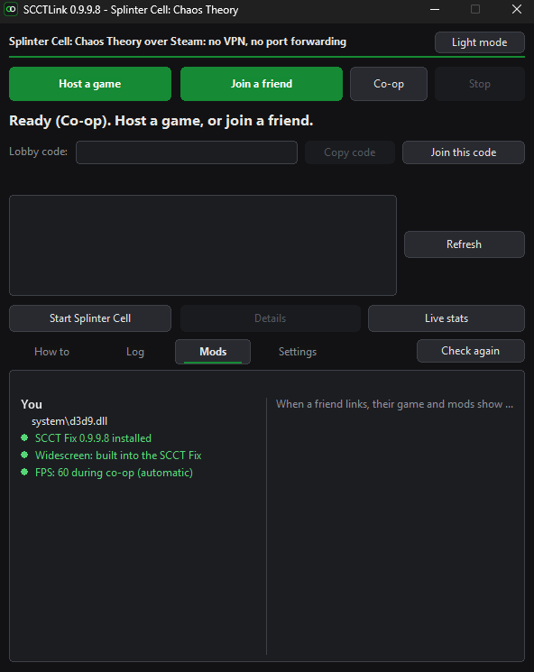
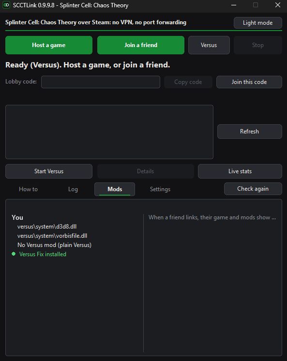
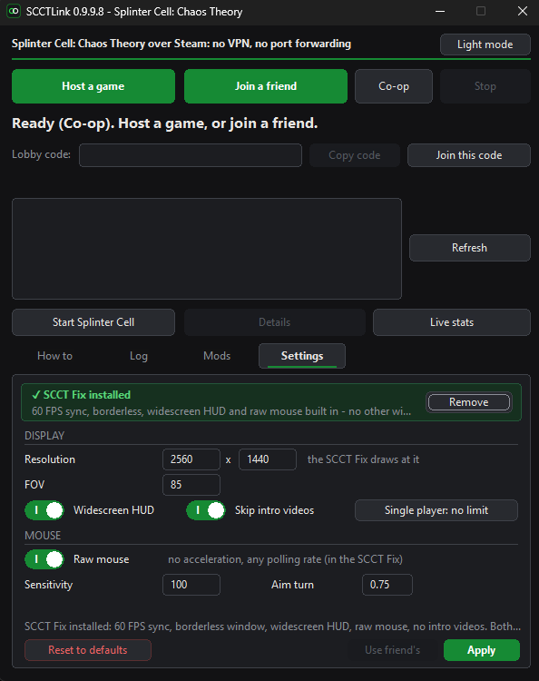
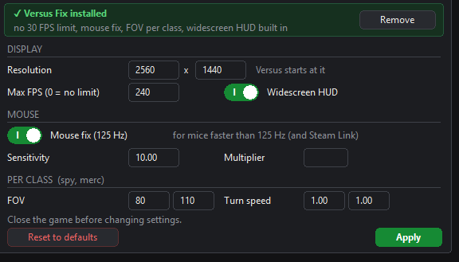

# SCCTLink

SCCTLink lets you play Splinter Cell: Chaos Theory online with your Steam
friends: the co-op campaign and Versus (Spies vs. Mercenaries).

It only works between Steam friends. Nobody else can see your game or
join it.

[**Download the latest release**](../../releases/latest) (Windows)

## Why it's needed

Ubisoft shut down the game's online servers, so the only multiplayer left
is LAN: both PCs have to be on the same network. To play with a friend in
another house, people install a VPN like Hamachi or Radmin to fake that
network: an extra program and account, your IP visible to the other side,
and often lag or disconnects.

SCCTLink does it through Steam instead. The host makes a normal LAN game,
SCCTLink carries it to your friend through Valve's servers, and the game
thinks you're on the same LAN. No VPN, nothing to set up on your router,
and neither of you sees the other's IP.

## Co-op (2 players)

Chaos Theory's co-op is fragile: it runs the same game on both PCs and
disconnects as soon as anything differs between them, like the frame
rate, a game file, a mod or a setting. SCCTLink deals with that:

- **The SCCT Fix**, installed with one click, holds both PCs at 60 FPS
  only while you're in a co-op game through SCCTLink, so the game doesn't
  drift apart. Outside co-op you choose in Settings: 60 FPS, your screen's
  refresh rate, or **FPS unlock** (the game itself stops at 100 FPS). It
  also fixes a few smaller things: the HUD isn't stretched on wide
  screens, the game runs at your screen's resolution, the FOV can be
  changed, and the mouse uses raw input.
  (These improvements work in the single-player story too.)
- **The Mods tab checks both PCs match**: the game files, mods and the
  settings that co-op needs to be the same. If something is different, it
  tells you what and on whose PC, so you can fix it before you play.

## Versus (up to 4 players)

SCCTLink is made for playing Versus with your friends, in a private game.

If you want to play online with other people (public servers, a server
list), use [Enhanced SCCT Versus](https://github.com/Joshhhuaaa/EnhancedSCCTVersus),
which is made for that.

Versus has its own problems on today's PCs, and the **Versus Fix**
(one click in SCCTLink) fixes them:

- the game is locked to 30 FPS: the limit is removed
- aiming zigzags with fast mice: the mouse is sent the way Versus expects
- the picture is stretched on wide screens, and the game keeps going back
  to 1600x1200: your resolution is used, and the HUD keeps its shape
- the mercenary's flashlight doesn't light anything on today's graphics
  cards: it works again
- FOV and turning speed can be set for spies and mercenaries separately

You don't install anything. Unzip it and open `SCCTLink.exe`. Everyone
playing needs it.

## Getting started

### What you need

- Splinter Cell: Chaos Theory on Steam
- Steam open and online
- The other players on your Steam friends list
- The same SCCTLink version as your friends

### Open SCCTLink

1. Download `SCCTLink-<version>.zip` from [Releases](../../releases/latest)
   and unzip it anywhere (the Desktop is fine). Keep the files together.
2. Open `SCCTLink.exe`. Windows asks for administrator rights: SCCTLink
   changes the game's settings files, which are inside Program Files.
3. If Windows says "Windows protected your PC", click **More info**, then
   **Run anyway**. It shows up because SCCTLink is new and not signed with a
   paid certificate.

The button next to **Join a friend** says **Co-op** or **Versus**. Click it
to switch. Everyone picks the same one.

### Co-op

**First time (both players, once):**
1. Start the game once from Steam and close it, so it makes its settings files.
2. In SCCTLink, open the **Settings** tab and click **Install** in the
   SCCT Fix banner at the top.
3. Start the game once more and close it. From then on it's ready.

**Host:**
1. Click **Host a game**.
2. Click **Start Splinter Cell**, then in the game: **Co-op → LAN → Create game**.
3. Leave SCCTLink open while you play.

**Friend:**
1. Click **Join a friend**, pick the host and click **Join**.
   Not in the list? Click **Refresh**, or paste the host's lobby code
   (like `1MCE-2B2`) and click **Join this code**.
2. When SCCTLink says you're linked, click **Start Splinter Cell**, then
   in the game: **Co-op → LAN → Join game** and pick the host.
3. Leave SCCTLink open while you play.

### Versus

**First time (everyone, once):**
1. Start Versus once, make a profile, and close the game. SCCTLink can't
   set things up before the profile exists.
2. In SCCTLink, switch the button to **Versus**, open the **Settings** tab
   and click **Install** in the Versus Fix banner.

**Host:** click **Host a game**, then **Start Versus** and create a LAN game.

**Friends:** click **Join a friend**, pick the host and click **Join**.
When you're linked, click **Start Versus** and join the host from the LAN list.

## The tabs

### How to
Your steps for hosting or joining, ticked off as they happen:
`[x]` done, `[>]` do this now.

### Log
Everything SCCTLink did. A dot on the tab means something needs a look.
- **Copy log** copies it, so you can send it to a friend.
- **Report** opens a problem report on GitHub, filled in, and the folder
  with `scctlink.log` so you can drag it in. Reports are public. The log
  has no IP addresses, but it does have your Steam friends' names.

### Mods
Compares your game with your friend's. The line on top is green when
**all party members match**, or says who doesn't. Under it: your mods on
the left, your friend's on the right, then every difference in red.
Click **Check again** after you change something.
Co-op compares only the co-op files; Versus compares only the Versus folder.

<p align="center">
  
  
</p>

### Settings
On top, the fix for this mode: installed (green) or not (red), with its
**Install**, **Update** or **Remove** button. Close the game before you
change anything here: it saves its own settings when it closes.

<p align="center">
  
</p>

**Co-op**
- **Display:** resolution, FOV (75 is the game's own), **Widescreen HUD**,
  **Skip intro videos**, and the single-player frame rate: 60 FPS, your
  screen's refresh rate, or **FPS unlock**.
- **Mouse:** **Raw mouse**, sensitivity, and **Aim turn** (how fast you
  turn while aiming; both players need the same).
- **Use friend's** copies your friend's values into the fields.

**Versus**
- **Display:** resolution (Versus starts at it), **Max FPS** (0 = no
  limit) and **Widescreen HUD**.
- **Mouse:** **Mouse fix (125 Hz)** (for mice faster than 125 Hz),
  sensitivity and multiplier.
- **Per class:** FOV and turn speed, for spies and mercenaries.

<p align="center">
  
</p>

**Reset to defaults** is on the left, **Apply** on the right. The first
time a file is changed, the original is kept next to it as
`<name>.scctlink-backup`.

### Other buttons
- **Live stats:** text on top of the game with the ping and packet loss
  for each friend. Drag it anywhere; right-click it to close.
- **Kick** (host): removes a friend. **Stop** ends hosting or joining.
- **Light mode / Dark mode** at the top right.

## Troubleshooting

**Your friend can't find the host**
- The host must be in the game first: **Co-op → LAN → Create game**.
- The friend clicks **Refresh**, or pastes the host's lobby code and
  clicks **Join this code**.

**The host's game isn't in the game's LAN list**
1. Both players click **Details**. In the Log, "Your game: running" must
   show on both PCs.
2. The friend restarts the game while SCCTLink stays linked.
3. Still nothing? Both click **Report** in the Log tab and attach
   `scctlink.log`. It has no IP addresses.

**Co-op disconnects**
- The SCCT Fix must be installed on both PCs.
- The **Mods** tab must say **All party members match**. Fix anything in red.
- Playing co-op over LAN without SCCTLink? Set the single-player frame
  rate to 60 FPS on both PCs. SCCTLink only holds 60 FPS by itself while it
  hosts or joins.

**The resolution or settings didn't change**
- Close the game before you click **Apply**. The game saves its own
  settings when it closes and would overwrite yours.
- Co-op, first install: start the game once more after installing the SCCT Fix.
- Versus: make a profile in Versus first, then close it and apply.

**"Different SCCTLink version"**
- Everyone needs the same SCCTLink zip.

**Windows Firewall asks about Splinter Cell or SCCTLink**
- You can click **Cancel**. The game's traffic only goes through your own
  PC (127.x.x.x addresses), so nothing needs to be opened.

**Thermal vision doesn't show heat on AMD graphics cards**
- A known problem of the game itself: with AMD cards, thermal vision may
  show no heat, or only cold surfaces. There is a fix for it made by the
  community, but it isn't part of SCCTLink.
- Not tested yet: whether co-op still works when only one player has that
  fix. If the fix adds or changes game files, the **Mods** tab shows it as
  a difference.

## What the fixes solve

### SCCT Fix (co-op and story)

- **Co-op disconnects:** the two PCs drifted apart when their frame rates
  differed. While SCCTLink hosts or joins, the game is held at 60 FPS on
  both PCs. The rest of the time you choose: 60, your screen's refresh
  rate, or FPS unlock (the game itself stops at 100).
- **Stretched HUD on wide screens:** the HUD and menus keep their shape.
- **Wrong resolution:** the game runs at the resolution you choose, or your
  screen's, even with Windows display scaling.
- **FOV can't be changed:** the game ignores its own FOV setting, so the
  fix sets the camera's FOV. Wide screens also see more on the sides.
- **Mouse acceleration:** raw mouse input, with any polling rate.
- **Alt+Tab problems:** the game runs in a borderless window.

The widescreen HUD, FOV and raw mouse come from ThirteenAG's
[FusionFix](https://github.com/ThirteenAG/WidescreenFixesPack) (MIT).

### Versus Fix

- **Locked to 30 FPS:** the limit is removed (Max FPS in Settings).
- **Aim zigzags with fast mice:** the mouse is sent the way Versus expects
  (125 reports a second).
- **Keeps going back to 1600x1200:** each time Versus starts and closes,
  your resolution is set again in the game's files and profiles.
- **Stretched HUD on wide screens:** the HUD keeps its shape.
- **Mercenary's flashlight doesn't light anything:** Versus is switched to
  its other way of drawing shadows, which works on today's graphics cards.
- **One FOV and turn speed for everyone:** set them for spies and
  mercenaries separately.

## How it works

```
 Friend's PC                                              Host's PC
┌─────────────────┐  UDP/TCP  ┌──────────┐            ┌──────────┐  UDP/TCP  ┌─────────────────┐
│ Splinter Cell   │ ────────▶ │ SCCTLink │ ═ Steam ══▶│ SCCTLink │ ────────▶ │ Splinter Cell   │
│ (joins the LAN  │ ◀──────── │ 127.x    │ ◀═ relay ═ │ 127.y    │ ◀──────── │ (hosts the LAN  │
│  game)          │           └──────────┘            └──────────┘           │  game)          │
└─────────────────┘                                                         └─────────────────┘
```

- **A LAN on your own PC.** SCCTLink reads which ports the game has open and gives each other player a private loopback address (`127.x.y.z`) with the same ports. To your game, your friend's game looks like another PC on your LAN.
- **LAN discovery** (the game's "Join game" list) is caught and passed on, so the host's game shows up in the list.
- **Addresses swapped, never sent.** Chaos Theory's network library (Quazal Net-Z) writes the PC's LAN address into its packets, including an RC4-encrypted discovery reply and LZO-compressed game messages. SCCTLink decrypts or decompresses them, swaps the address for the loopback stand-in, and redoes the checksums and the MD5, so your friend's game connects through Steam and never learns your real address.
- **Lobbies and the relay** come from Valve's free *Spacewar* test app (AppID 480), which every Steam account can use. While SCCTLink is open, Steam shows you as "playing Spacewar". Nobody has to install or buy anything extra.
- **Packets arrive unchanged and in order**, adding about 1–2 ms.

## Safety and privacy

| | |
|---|---|
| 🔒 **Your IP stays private** | Traffic always goes through Valve's relay. SCCTLink turns off Steam's direct connections, so neither player sees the other's IP, whatever Steam's "IP sharing" setting is. If the game writes your LAN address into a packet, it is replaced before it leaves your PC. |
| 👥 **Friends only** | The host only lets in people who are in its friends-only lobby **and** on its Steam friends list. Everyone else is blocked and logged. |
| 🎯 **You choose who to link to** | The friend links only to the host they picked, and only accepts data from that host. |
| 🚪 **Kick** | The host can kick a friend. A kicked friend can't link again until the host clicks Stop. |
| 🧱 **Nothing opened** | No ports are opened on your PC or router. SCCTLink only listens on loopback addresses (your own PC). |
| 🎮 **Only the game** | Packets from other programs, or from other PCs on your network, are dropped. |
| 📦 **Packets checked** | Oversized packets and floods are dropped; compressed and encrypted data is bounds-checked before it is read. |
| ✅ **Checked files** | `steam_api.dll` is Valve's signed file from [Steamworks.NET 2025.164.1](https://github.com/rlabrecque/Steamworks.NET/releases/tag/2025.164.1); SCCTLink checks its SHA-256 (`fdafb7c6…eb65da`) and refuses anything else. The SCCT Fix and the Versus Fix are built from this repo and checked the same way before they're installed; neither uses the network or starts programs. |
| 🧩 **No third-party code** | `SCCTLink.exe` uses only core Windows DLLs (kernel32, user32, gdi32, comctl32, shell32, ws2_32, msvcrt). A few more (winmm, iphlpapi, dwmapi, uxtheme) are loaded from System32 only. |
| ✍️ **What it writes** | In its own folder: `steam_appid.txt`, `scctlink.log` (never contains IP addresses), `scctlink_cache.txt` (game file checksums) and `scctlink_theme.txt`. In the game folder: the settings files when you click **Apply**, and the fix when you click **Install** or **Remove**, always with backups. While it hosts or joins co-op it also leaves `System\SCCTLink.coop` (the 60 FPS signal). The Versus Fix sets the resolution lines in Versus' `Default.ini` and profiles each time Versus starts and closes. To remove everything, click **Remove** on each fix and delete SCCTLink's folder. |
| 🛡️ **No ban risk** | Chaos Theory's LAN mode has no anti-cheat and its online servers are gone. SCCTLink itself doesn't touch the running game; the fixes are files the game loads by itself, like any graphics mod. |

Windows SmartScreen may warn you because SCCTLink is new and not code-signed. Check the files first if you like: open a command prompt in the folder and compare `certutil -hashfile SCCTLink.exe SHA256` with `SHA256SUMS.txt`.

As with any game, only play with people you trust. Found a security problem? See [SECURITY.md](SECURITY.md).

## For developers

### Building

You need `clang`, `lld`, `llvm-dlltool`, `llvm-rc` and `llvm-cvtres`. No
Windows SDK: the few Windows functions used are declared by hand.

```sh
sh build_windows.sh                    # build/win/SCCTLink.exe (32-bit)
sh fix/build_fix.sh                    # build/fix/d3d9.dll and d3d8.dll (the two fixes)
sh package.sh path/to/steam_api.dll    # dist/SCCTLink-<version>.zip
```

The builds are reproducible: the same source always gives the same
SHA-256, and SCCTLink only installs fix files with the expected one.

### Tests

The tests run on Linux as root, with a mock Steam and a stand-in for the
game, under AddressSanitizer and UBSan. Each player gets its own network
namespace (a separate "PC").

```sh
mkdir -p build
gcc -std=c11 -fsanitize=address,undefined -o build/scctlink_mock src/scctlink.c src/ui_console.c src/lobbycode.c src/plat_posix.c src/sha256.c test/steam_mock.c
sudo python3 test/run_tests.py   # prints ALL OK
```

They cover joining and playing (packets exact and in order, TCP, 10%
loss with 60 ms delay, Versus with three "PCs"), privacy (addresses hidden
in every form the game sends them, direct connections off), safety
(strangers and other programs blocked, kicking), finding the host, the
Mods check and the Settings tab.

### Project layout

| File | What it does |
|---|---|
| `src/scctlink.c` | Lobbies, relay, address hiding, safety checks, Mods check, settings, installing the fixes |
| `src/ui_win.c` | The window and Live stats |
| `src/ui_console.c` | A text front end that the tests drive |
| `src/steam_win.c` | Loads the checked `steam_api.dll` |
| `src/plat_win.c` | Windows sockets, the game's open ports, file helpers |
| `src/lobbycode.c`, `src/sha256.c` | Lobby codes, checksums |
| `fix/d3d9fix.c` | The SCCT Fix |
| `fix/d3d8versus.c` | The Versus Fix |
| `res/`, `package/` | Icon and manifest; the player guide in the zip |
| `test/` | Mock Steam, the game stand-in and the tests |

## Credits

By [Mhdshehri](https://github.com/Mhdshehri).
- The widescreen HUD, camera FOV and raw mouse in the SCCT Fix are ported
  from ThirteenAG's [FusionFix](https://github.com/ThirteenAG/WidescreenFixesPack)
  (MIT, see `THIRD-PARTY.txt`).
- The relay idea comes from the [Co-op Anything](https://github.com/cranebeaker/coop-anything)
  playbook (Steam Spacewar networking).

Splinter Cell: Chaos Theory is by Ubisoft. SCCTLink is not affiliated with
Ubisoft or Valve.

SCCTLink's own code is under the [MIT license](LICENSE). `steam_api.dll`,
which ships in the release zip, is Valve's Steamworks redistributable
(from Steamworks.NET 2025.164.1). It is not covered by the MIT license; it
is distributed under the Steamworks SDK terms.
